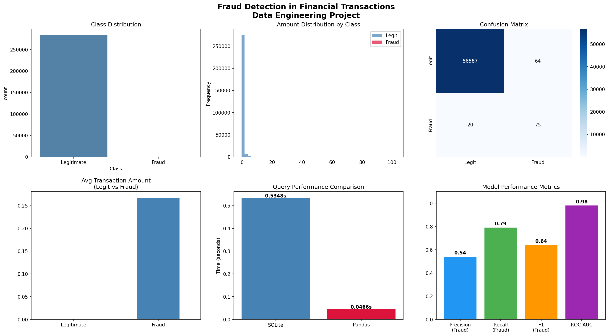
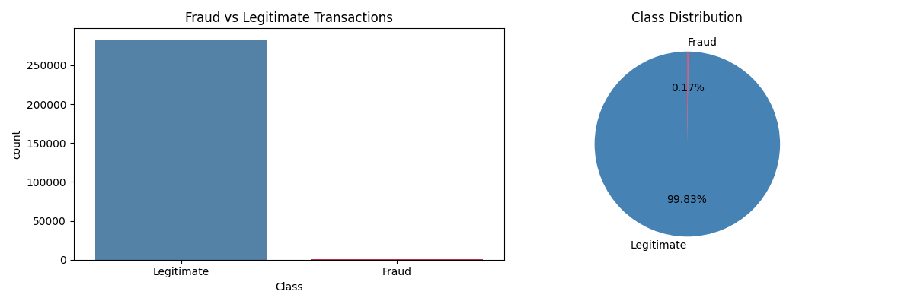
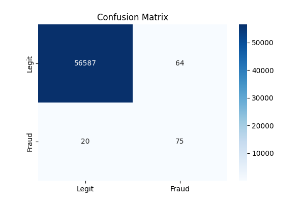
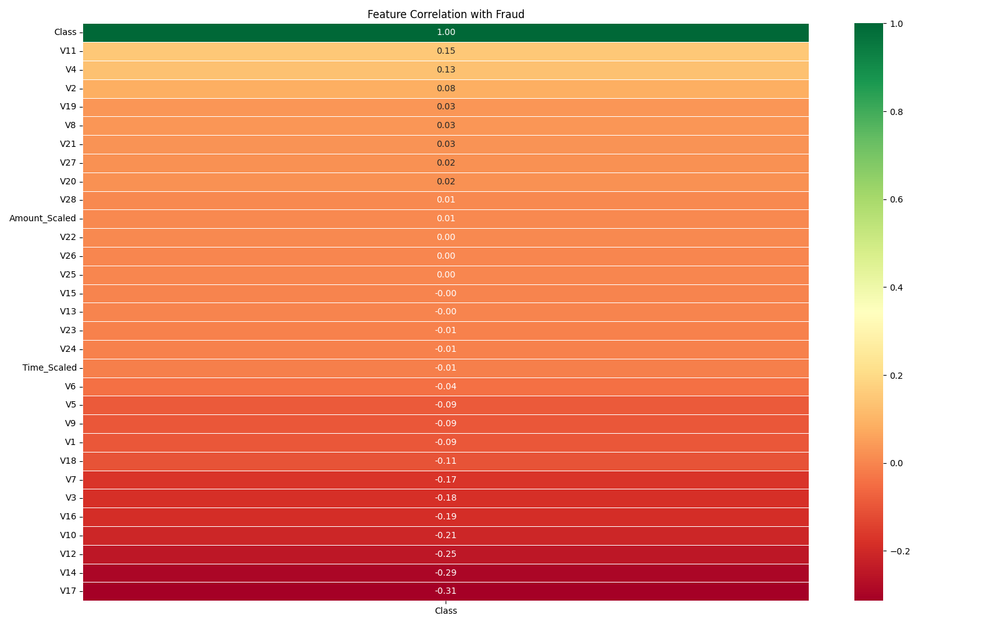
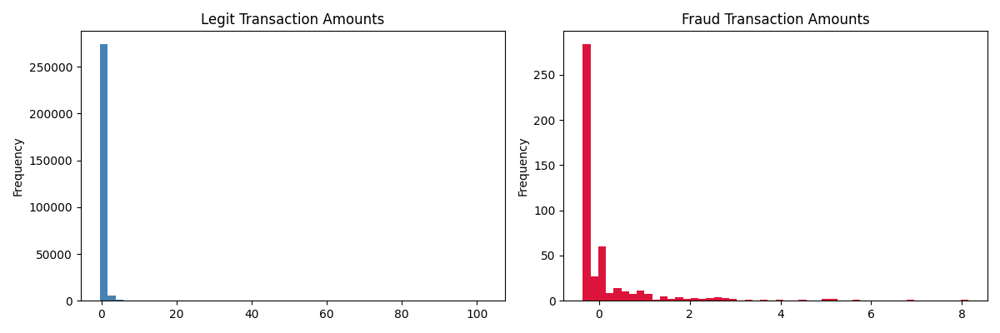
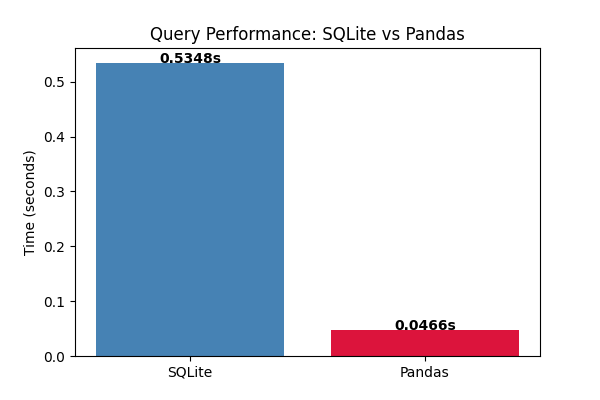

# Financial Transaction Fraud Detection System

An end-to-end Machine Learning project that detects fraudulent financial transactions using data preprocessing, exploratory data analysis, SMOTE-based class balancing, and Random Forest classification.

## 📌 Project Overview

Financial fraud is a major challenge in digital payment systems. Since fraudulent transactions represent only a small portion of total transactions, detecting them accurately is difficult due to highly imbalanced datasets.

This project aims to identify potentially fraudulent transactions by developing a machine learning pipeline that analyzes transaction patterns and classifies transactions as legitimate or fraudulent.

## 🎯 Objectives

- Analyze financial transaction data to identify fraud patterns.
- Perform data preprocessing and exploratory data analysis (EDA).
- Handle class imbalance using SMOTE.
- Train a Random Forest classification model.
- Evaluate model performance using ROC-AUC.
- Build an ETL pipeline for data processing and analysis.
- Compare Pandas and SQLite processing performance.
- Perform multidimensional fraud analysis using OLAP concepts.

## 🛠️ Technologies & Tools Used

| Category | Technologies |
|---|---|
| Programming Language | Python |
| Data Processing | Pandas, NumPy |
| Data Visualization | Matplotlib, Seaborn |
| Machine Learning | Scikit-learn |
| Class Balancing | SMOTE (Imbalanced-learn) |
| Classification | Random Forest |
| Database | SQLite |
| Development Environment | Jupyter Notebook |

## ⚙️ Project Workflow

### 1. Data Loading
Loaded the Credit Card Fraud Detection dataset and explored its structure, features, and class distribution.

### 2. Data Preprocessing & EDA
- Examined missing values and data distributions.
- Analyzed transaction patterns.
- Visualized fraudulent and legitimate transaction distributions.
- Studied correlations between features.

### 3. Handling Imbalanced Data
Applied SMOTE (Synthetic Minority Over-sampling Technique) to address class imbalance and improve the model's ability to learn fraudulent transaction patterns.

### 4. Model Development
Implemented a Random Forest classification model to distinguish fraudulent transactions from legitimate ones.

### 5. Model Evaluation
Evaluated the model using ROC-AUC to measure its ability to distinguish between fraudulent and legitimate transactions.

### 6. Data Warehousing & OLAP
Developed an ETL pipeline and used SQLite for structured data storage and multidimensional fraud pattern analysis.

### 7. Performance Comparison
Compared Pandas-based processing with a traditional SQLite-based approach to analyze execution performance.

## 📊 Key Results

| Performance Metric | Result |
|---|---:|
| Random Forest ROC-AUC | **0.979** |
| Pandas Processing Speedup | **11.5×** |

The results demonstrate strong classification performance and improved processing efficiency in the Pandas-based pipeline compared with the SQL-based approach.

## 📈 Visualizations

The project includes the following visualizations:

### Fraud Detection Dashboard


### Class Distribution


### Confusion Matrix


### Correlation Analysis


### Transaction Amount Distribution


### Database Performance Comparison


## 📂 Project Structure

```text
Financial-Transaction-Fraud-Detection/
│
├── README.md
│
└── fraud-detection/
    ├── frauddetector.ipynb
    ├── Untitled.ipynb
    ├── fraud_detection_dashboard.png
    ├── class_distribution.png
    ├── amount_distribution.png
    ├── confusion_matrix.png
    ├── correlation.png
    ├── db_comparison.png
    └── .gitignore
```

## 🚀 How to Run the Project

### Prerequisites
- Python 3.x
- Jupyter Notebook

### 1. Clone the repository

```bash
git clone https://github.com/Piya0217/Financial-Transaction-Fraud-Detection.git
```

### 2. Navigate to the project directory

```bash
cd Financial-Transaction-Fraud-Detection
```

### 3. Install the required libraries

```bash
pip install pandas numpy matplotlib seaborn scikit-learn imbalanced-learn jupyter
```

### 4. Download the dataset

Download the Credit Card Fraud Detection dataset from Kaggle:

https://www.kaggle.com/datasets/mlg-ulb/creditcardfraud

Place the downloaded `creditcard.csv` file in the `fraud-detection/` directory.

### 5. Launch Jupyter Notebook

```bash
jupyter notebook fraud-detection/frauddetector.ipynb
```

Run the notebook cells sequentially to explore the analysis and model implementation.

*Note: If your notebook uses a different dataset path, update the file path accordingly.*

## 👩‍💻 Project Information

**Project:** Financial Transaction Fraud Detection System

**Domain:** Machine Learning | Data Science | Financial Analytics

**Primary Algorithm:** Random Forest Classifier

**Key Techniques:** SMOTE, EDA, ETL, OLAP

**GitHub:** [Piya0217](https://github.com/Piya0217)

---

*This project demonstrates the application of Machine Learning and data analytics techniques to address real-world financial fraud detection challenges.*